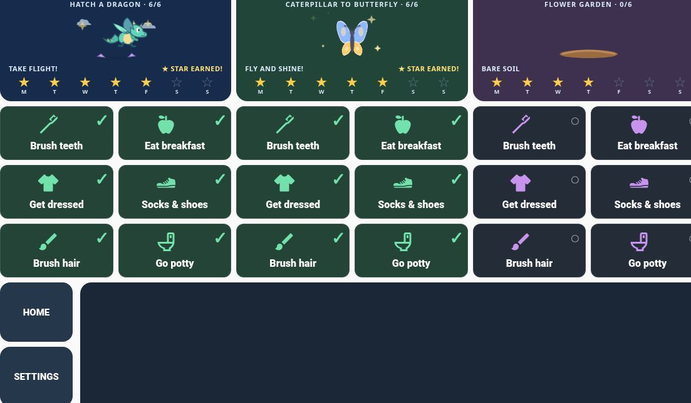
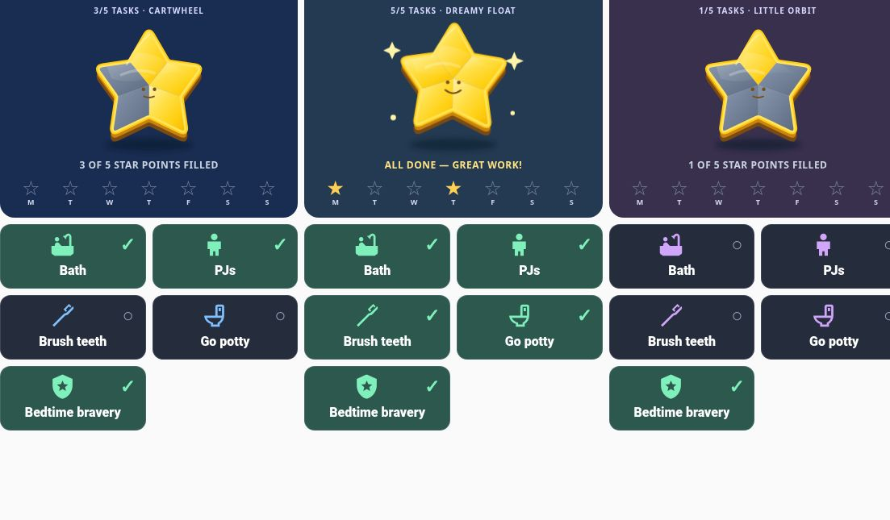
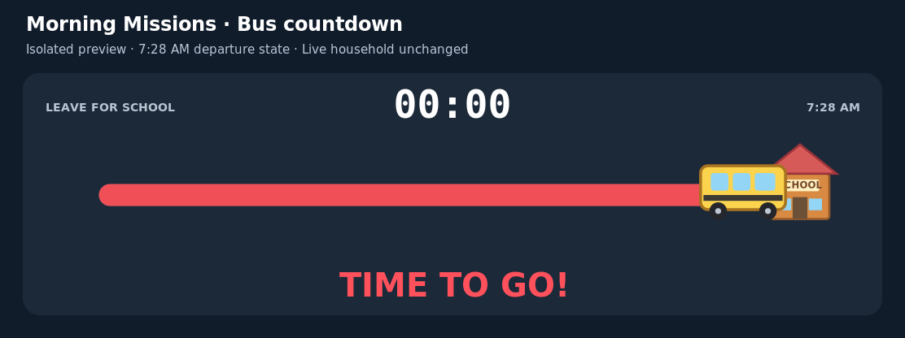

# Home Assistant Family Routines

Animated Morning Missions and Nighttime Routine dashboards for a landscape wall display.

## Status

Private source archive of the existing installation, with both backend packages and live screenshots. Dashboard source comes from the November 5, 2026 configuration snapshot. Morning, nighttime, and preview helper packages were retrieved from the running installation on November 6, 2026; the morning package matches that snapshot. This is a configuration bundle, not a packaged integration or a fresh-install-tested release.

Names and entity IDs are anonymized as `child_one`, `child_two`, and `child_three`. Replace these consistently with your own identifiers before installing on an existing system. No Home Assistant hostnames, credentials, webhook URLs, device data, or unrelated dashboard sections are included.

## Features

- Morning checklist: brush teeth, breakfast, get dressed, socks/shoes, brush hair, and go potty.
- Per-child daily animation choice: a fixed favorite or Surprise.
- Animated task progression, including a hatching dragon that flies when complete.
- Weekly stars and daily task reset logic.
- Morning countdown with “Finish up!” and “Time to go!” stages.
- Settings shortcut to the hidden Animation Preview view.
- Nighttime checklist: bath, pajamas, brush teeth, go potty, and bedtime bravery.
- Five-point star progress and nighttime completion animation.

## Files

- `dashboard.yaml`: the three routine views only. Extracted from the existing dashboard snapshot; unrelated Home, weather, laundry and note cards are excluded.
- `morning_missions_package.yaml`: morning helpers, automations, preferences, scripts, and dragon preview helper.
- `nighttime_missions_package.yaml`: five nightly tasks, randomized star animations, weekly rewards, resets, and reroll script.
- `morning_missions_animation_preview_helpers.yaml`: remaining animation preview sliders.
- `morning-missions.jpg` and `nighttime-routine.jpg`: actual live dashboard screenshots, cropped to exclude names and unrelated UI.

## Screenshots

Captured November 6, 2026. Cropping removes the child-name header and part of the right edge; these are not mockups. No task states were changed for these screenshots.

### Morning Missions

### Nighttime Routine

### Bus countdown: Time to go!

Clearly labeled isolated preview of the 7:28 AM departure state, using the dashboard's actual bus/road/school SVG, colors, countdown, and warning text. The surrounding layout is recreated for documentation; this is not a live dashboard screenshot. The flashing warning is shown in its visible phase. No live clock, helpers, or household state were changed.

## Dependencies and installation notes

Home Assistant and the community `custom:button-card` frontend resource are required. This is a YAML dashboard/package project, not a custom integration or HACS-installable repository.

Back up the target dashboard and packages first. For an existing installation, do not add a second copy of helpers or automation IDs. Merge deliberately. The dashboard navigation paths currently use `/wall-tab/...`; change these if your dashboard URL differs. Its Home button assumes a Home view in that dashboard, which is not included here.

The morning package is intended for Home Assistant's packages configuration. Review your existing `homeassistant: packages:` include before placing a package file under `/config/packages/`. Run Home Assistant's configuration validation and reload/restart only as required by the changed helper types. Use the dashboard raw editor to merge these views rather than replacing unrelated views.

Install all three package files under your configured packages directory. The preview helper package supplies the original sliders; the morning package supplies the dragon slider. Avoid defining the same helper twice.

Nighttime tasks reset daily at 4 PM, with a restart catch-up check. Weekly nighttime stars reset on Mondays. Review all reset times, countdown thresholds, task labels, and animation preferences before adapting this for another household. The export uses `child_one`, `child_two`, and `child_three` consistently across dashboard and packages; it is not a drop-in overwrite of the original named installation.

## Validation limits

All four YAML files parse successfully. The 154 embedded dashboard JavaScript templates also pass syntax parsing. The live morning package matches the archived source. No Home Assistant configuration was changed during export. This archive has not been installed into a fresh Home Assistant instance. Existing behavior and history are not a substitute for fresh-install testing. Review entity references and navigation paths before use.
